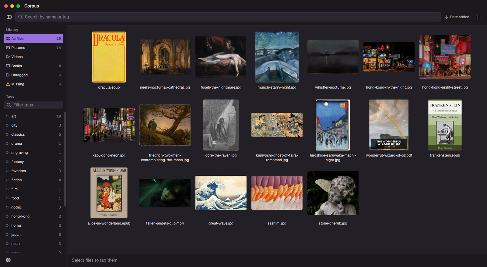
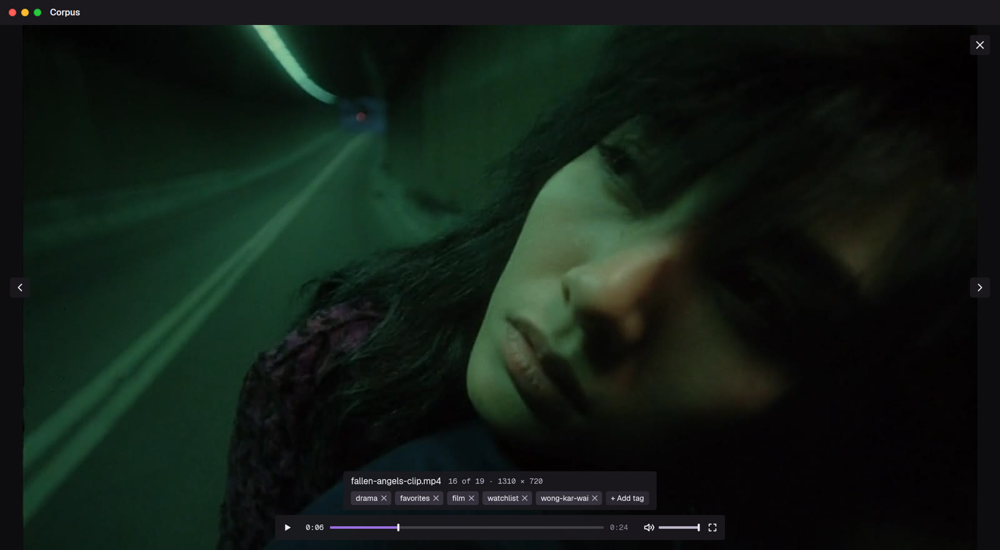
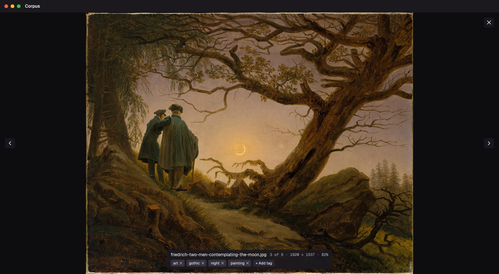
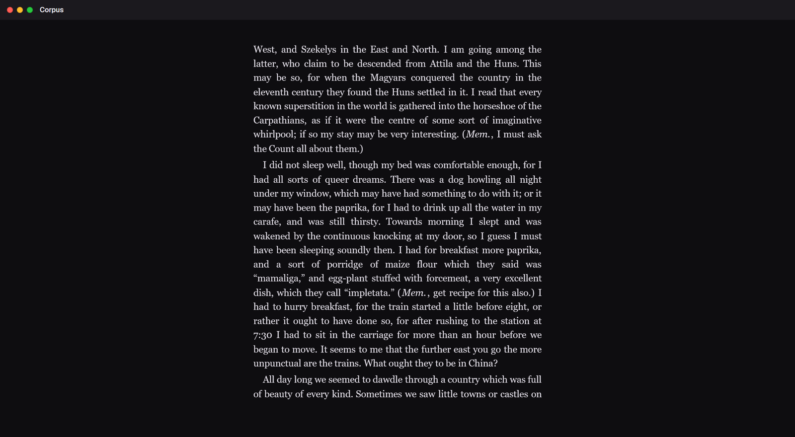

<div align="center">


# Corpus

*A catalog for your personal files*

[](#getting-started)
[](https://en.cppreference.com/w/cpp/17)
[](LICENSE)

[Features](#features) • [Getting started](#getting-started) • [Searching](#searching) • [Keyboard shortcuts](#keyboard-shortcuts) • [CLI](#cli)

</div>

Corpus tags the files you already have and finds them again. Drop in a folder, tag what's in it, then search by name and tags together. Pictures, videos and books open in a built-in viewer. Everything else opens in its default program.

Corpus is a native Windows app built with Win32 and Direct2D, with no UI framework. It ships as a single `.exe`, and the library is stored in SQLite.

<div align="center">


</div>

<table>
  <tr>
    <td></td>
    <td></td>
  </tr>
  <tr>
    <td></td>
    <td></td>
  </tr>
</table>

> [!NOTE]
> Corpus only stores where your files are. It never copies, moves or changes them, unless you rename a file or send it to the Recycle Bin from inside the app.

## Features

- **Bring in whole folders.** Drag files or folders into the window, or use *Add folder…* (the **+** at the right of the search bar, or <kbd>Ctrl</kbd>+<kbd>O</kbd>). The scan runs in the background, can be cancelled, and skips system files such as `desktop.ini` and `Thumbs.db`. Afterwards Corpus lists the folder names it could use as tags (a file in `Holiday 2023\Beach` suggests `Holiday_2023` and `Beach`), and only the ones you tick are applied.
- **Folders stay up to date.** Every folder you bring in is watched: files saved in it later, even while Corpus is closed, join the library untagged, with a quiet notice such as *12 new files in Pictures*. A file moved between watched folders on the same drive keeps its tags, and a file you remove from the library stays out. *Settings* lists the watched folders; *Stop watching* keeps their files. Folders on USB drives and memory cards are checked when Corpus comes back to the front, so the drive can still be ejected.
- **Tag many files at once.** Select files, press <kbd>Ctrl</kbd>+<kbd>T</kbd> (or use *Add tag* in the menu, or *+ Add tag* in the strip or info pane) and type. Tag names autocomplete from your library, most-used first. Tags that only some of the selected files have are marked, and one click adds them to the rest. You can also drag the selected files onto a tag in the sidebar.
- **Rename a tag.** Right-click it in the sidebar, or hover it and press <kbd>F2</kbd>. Renaming to a name another tag already has merges the two, after asking.
- **Search by name and by tag.** Plain text and boolean tag expressions work in the same box (see [Searching](#searching)). The sidebar's tag list writes those expressions for you: click a tag to require it, again to exclude it, and a third time to clear it.
- **Built-in viewer:**
  - **Pictures:** anything Windows can decode (JPEG, PNG, GIF, BMP, TIFF, ICO and WebP, plus HEIC, AVIF and camera RAW once their Microsoft Store extensions are installed). Zoom with the wheel, pan by dragging.
  - **Videos:** played with [libmpv](https://mpv.io/), with hardware decoding, subtitle and audio track menus, and fullscreen.
  - **Books:** PDF, comic books (`.cbz`), EPUB, plain text, Markdown and HTML, read page by page. They reopen where you stopped, with fit-to-width and right-to-left reading for manga.
  - **Tags while you look:** the file's tags show as chips under its name. Click a chip's x to take the tag off, or press <kbd>Ctrl</kbd>+<kbd>T</kbd> (or *+ Add tag*) to add one.
- **Sort the grid** by date added, name, size or type, either way round, from the button next to the search bar. Corpus remembers the order.
- **Undo.** <kbd>Ctrl</kbd>+<kbd>Z</kbd> takes back tagging, untagging, tag renames and merges, and removing files from the library (they come back with their tags); <kbd>Ctrl</kbd>+<kbd>Y</kbd> redoes. Questions such as "Remove 3 files from the library?" are asked inside the window, without a system sound.
- **Take files out again.** Drag files from the grid into Explorer, a chat or any other program, or copy them with <kbd>Ctrl</kbd>+<kbd>C</kbd> and paste them there. They leave as copies; the originals stay where they are. *Show in Explorer* in the right-click menu opens the folder with the files selected.
- **Thumbnails and covers.** The same thumbnails Explorer shows, plus covers for books: a PDF's first page, a comic's first picture and an EPUB's cover. All made in the background and cached on disk.
- **Library views.** *All files*, *Pictures*, *Videos*, *Books* (PDF, EPUB, comics, text and other ebook formats), *Untagged*, and *Missing* (files that are no longer at their saved path, shown faded with a warning badge everywhere).
- **Moved files can be found again.** Corpus records each file's identity from the file system (the NTFS file ID, or the inode on Linux). In the *Missing* view, *Find moved files…* searches a folder you pick for files that were moved or renamed outside Corpus and, after you confirm, points the library to their new place with their tags. The [CLI](#cli) can do the same. FAT and exFAT drives don't have these IDs.
- **"Open with" integration.** One setting adds Corpus to Explorer's *Open with* menu for the file types it can show. The setting writes only to your user registry (no admin rights needed) and doesn't change any default program.

## Getting started

Corpus is cross-compiled for Windows with MinGW-w64, from Linux or from WSL.

### Prerequisites

- Windows 10 or later (x64) to run it
- Linux or [WSL](https://learn.microsoft.com/windows/wsl/install) with CMake 3.16+, a C++17 compiler and MinGW-w64 to build it:

  ```bash
  sudo apt install cmake g++ mingw-w64
  ```

All other dependencies are already in `third_party/`.

### Build

```bash
git clone https://github.com/GothHeit/Corpus.git
cd Corpus
cmake -B build-gui -DCMAKE_TOOLCHAIN_FILE=cmake/mingw-toolchain.cmake
cmake --build build-gui
```

Builds are Release (optimized and stripped) unless you pass `-DCMAKE_BUILD_TYPE=...`. The build produces `build-gui/Corpus.exe`. It's statically linked and has its fonts built in, so you can copy it anywhere on Windows and double-click it.

### Add video playback (optional)

Corpus plays videos through `libmpv-2.dll`. To fetch it, run this script from WSL **before** configuring the build. If you already configured, run the `cmake -B` line again afterwards:

```bash
powershell.exe -NoProfile -ExecutionPolicy Bypass -File "$(wslpath -w tools/get-libmpv.ps1)"
```

The script downloads a pinned build, checks its SHA-256 and puts the DLL in `build-gui/`, where CMake compresses it (with Python 3) and builds it into the `.exe`. The DLL is only unpacked the first time you open a video.

> [!TIP]
> Without libmpv, everything else still works, and videos open in their default program instead.

### Where your data lives

| What | Where |
| --- | --- |
| Library (SQLite) | `%LOCALAPPDATA%\Corpus\corpus.db` |
| Thumbnail cache | `%LOCALAPPDATA%\Corpus\thumbnails\` |

To use another library, for example to test something, start Corpus with `--library`:

```
Corpus.exe [--library <path to a .db file>] [file...]
```

Any files given on the command line open in the viewer. Only one window runs per library: starting Corpus again sends the files to the window that's already open.

> [!IMPORTANT]
> Keep the library on a local drive. SQLite's file locks don't work on network shares, and that includes `\\wsl.localhost`.

## Searching

The search box takes plain text and tag groups in `{braces}`. A file has to match all of them:

- **Words** outside the braces each have to appear somewhere in a file's path or tag names, in any order.
- **A group** is a boolean expression over tags.

Words ignore case and accents: `acao` finds `Ação`. In a group, a name means one tag, so only case is ignored there.

| Query | Finds |
| --- | --- |
| `akira` | files with "akira" in their path or tags |
| `akira 1988` | files with both "akira" and "1988", in either order |
| `{film}` | files tagged `film` |
| `{film -watched}` | films not tagged `watched` |
| `{image AND NOT icon}` | the same idea, spelled out |
| `{document OR music}` | files with either tag |
| `{movie (isshi OR katsuhiro)}` | movies with either of those tags |
| `pdf {university}` | files tagged `university` whose path contains "pdf" |

Tags written side by side are joined with `AND`, and `AND` binds tighter than `OR`. Write the operators `AND`, `OR` and `NOT` in uppercase. A `-` only negates at the start of a word, so `{sci-fi}` is a single tag.

## Keyboard shortcuts

<details>
<summary><b>Library</b></summary>

| Keys | Action |
| --- | --- |
| <kbd>Enter</kbd> | Open the selected files: in the viewer if Corpus can show them, otherwise in their default program |
| <kbd>Space</kbd> | Quick look at the selected file |
| <kbd>Ctrl</kbd>+<kbd>F</kbd> | Search. In the search box, <kbd>Enter</kbd> or <kbd>↓</kbd> goes to the first result and <kbd>Esc</kbd> clears it, then leaves it |
| <kbd>Tab</kbd> | Move between the search, the files and the tag filter |
| <kbd>Ctrl</kbd>+<kbd>T</kbd> | Tag the selected files |
| <kbd>Ctrl</kbd>+<kbd>Z</kbd> / <kbd>Ctrl</kbd>+<kbd>Y</kbd> | Undo / redo the last change to tags or the library |
| <kbd>Ctrl</kbd>+<kbd>C</kbd> | Copy the selected files, to paste in Explorer or another program |
| <kbd>Ctrl</kbd>+<kbd>O</kbd> | Add a folder |
| <kbd>Ctrl</kbd>+<kbd>I</kbd> | Show or hide the info pane |
| <kbd>Ctrl</kbd>+<kbd>B</kbd> | Show or hide the sidebar |
| <kbd>Ctrl</kbd>+<kbd>,</kbd> | Settings |
| <kbd>Ctrl</kbd>+<kbd>+</kbd> / <kbd>Ctrl</kbd>+<kbd>-</kbd> | Bigger or smaller thumbnails |
| <kbd>Ctrl</kbd>+<kbd>A</kbd> / <kbd>Esc</kbd> | Select all / clear the selection |
| <kbd>F2</kbd> | Rename the file on disk, or the tag under the pointer in the sidebar |
| <kbd>Del</kbd> | Remove from the library (the file stays on disk) |
| <kbd>Shift</kbd>+<kbd>Del</kbd> | Move to the Recycle Bin |

</details>

<details>
<summary><b>Viewer</b></summary>

| Keys | Action |
| --- | --- |
| <kbd>←</kbd> / <kbd>→</kbd> | Previous or next file |
| <kbd>Home</kbd> / <kbd>End</kbd> | First or last file |
| <kbd>+</kbd> / <kbd>-</kbd> / <kbd>0</kbd> | Zoom in, zoom out, fit to the window |
| <kbd>Z</kbd> | Switch a picture between fitting the window and its actual size (or double-click) |
| <kbd>F</kbd> | Fullscreen |
| <kbd>Ctrl</kbd>+<kbd>T</kbd> | Add tags to the file shown |
| <kbd>Ctrl</kbd>+<kbd>Z</kbd> / <kbd>Ctrl</kbd>+<kbd>Y</kbd> | Undo or redo, such as a tag taken off the file shown |
| <kbd>Esc</kbd> / <kbd>Space</kbd> | Close the viewer (in a book, <kbd>Space</kbd> reads on) |

**Videos:** <kbd>Space</kbd> or <kbd>K</kbd> plays and pauses, <kbd>←</kbd> / <kbd>→</kbd> seek while playing, <kbd>↑</kbd> / <kbd>↓</kbd> change the volume and <kbd>M</kbd> mutes.

**Books:** <kbd>←</kbd> / <kbd>→</kbd> turn pages, <kbd>Space</kbd> / <kbd>Shift</kbd>+<kbd>Space</kbd> scroll a screen on or back, <kbd>Home</kbd> / <kbd>End</kbd> go to the first or last page, <kbd>W</kbd> switches between fitting the whole page and its width, and <kbd>R</kbd> flips the reading direction. Hold <kbd>Ctrl</kbd> to move between files instead.

</details>

## CLI

`corpus-cli` is a text menu over the same core library, and it builds on Linux too. It can do a few things the window can't yet: import and export JSON libraries, find moved files in a folder and relink them, and edit reading progress by hand.

```bash
cmake -B build
cmake --build build
./build/corpus-cli              # opens libs/corpus.db
./build/corpus-cli other.db     # or any other database
```

Run it from the repository root. When the database is new, the CLI offers to import any `.json` file in `libs/`, such as [`libs/sample.json`](libs/sample.json).

## Tests

The same CMake build also produces three test programs. Each one prints `OK` or `FAILED` and returns a matching exit code:

```bash
./build/corpus-core-test        # tag queries, search, edits, moved files, migrations, folder import, watched folders
./build/corpus-roundtrip-test   # JSON import -> SQLite -> reopen, compared with an in-memory library
./build/corpus-litehtml-test    # the vendored HTML layout engine used by the EPUB reader
```

To check the Windows app itself, run `tools/smoke-test.ps1`. It starts `Corpus.exe` on a scratch library, checks that the window opens without an error dialog, types into it, saves a screenshot and closes it:

```bash
powershell.exe -NoProfile -ExecutionPolicy Bypass -File "$(wslpath -w tools/smoke-test.ps1)"
```

## Project layout

```
include/, src/     core library: files, tags, search, SQLite storage, folder scanning
apps/gui/          the Windows app (Win32, Direct2D, DirectWrite, WIC)
apps/cli/          the CLI and the test programs
tools/             libmpv download and GUI smoke test (PowerShell), libmpv packer (Python)
third_party/       SQLite, litehtml (EPUB layout), Geist fonts, libmpv header
cmake/             MinGW-w64 toolchain file
libs/sample.json   a small example library
```
